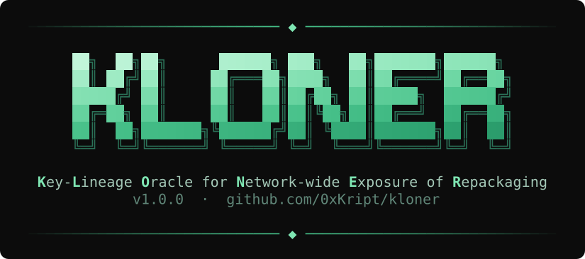
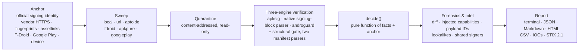

<p align="center">
  
</p>

# KLONER

Hunt forged, trojanized and tampered copies of any Android app across the internet, and prove every verdict
cryptographically.

[](https://github.com/0xKript/KLONER/actions/workflows/ci.yml)


## Why

Attackers clone the apps people trust most, such as banks, messengers and wallets. They inject code, re-sign
the result and spread it through APK mirrors, third-party stores and smishing links, and the copy looks
identical to the original. Malware scanners give probabilistic verdicts, comparison tools only diff files you
already hold, and naive certificate checks are fooled by a copied certificate. KLONER pins the vendor's real
signing identity once, sweeps the channels for copies, and proves for each copy, with the cryptography Android
itself uses, whether it is exactly what the vendor signed.

## Quick start

Linux or macOS, with Python 3.11+, a JDK 17+ and [uv](https://docs.astral.sh/uv/):

```bash
git clone https://github.com/0xKript/KLONER.git && cd KLONER
uv venv && . .venv/bin/activate
uv pip install --require-hashes -r requirements.lock && uv pip install --no-deps .
kloner setup            # JDK 17+ check, pinned Android build-tools 36.0.0, apkeep, the apksig bridge
kloner doctor           # every component PASS/FAIL, with fixes
```

### Windows: Docker Desktop (PowerShell)

The image holds the JDK, the pinned build-tools, apkeep and KLONER. Your anchors, quarantine and database live
on the `kloner-home` volume, and reports go to `.\reports`. Building the image installs Google's Android
build-tools, which requires the Android SDK License Agreement. Read it at
<https://developer.android.com/studio/terms>. The build argument `ACCEPT_ANDROID_SDK_LICENSE=yes` is your
acceptance. The build accepts only the license of the packages it installs and prints its text in the build log:

```powershell
git clone https://github.com/0xKript/KLONER.git
cd KLONER
docker build --build-arg ACCEPT_ANDROID_SDK_LICENSE=yes -t kloner .
docker volume create kloner-home
docker run --rm -t -e COLORTERM -e WT_SESSION -v kloner-home:/kloner kloner doctor
docker run --rm -t -e COLORTERM -e WT_SESSION -v kloner-home:/kloner kloner selftest
docker run --rm -t -e COLORTERM -e WT_SESSION -v kloner-home:/kloner kloner anchor add org.thoughtcrime.securesms --from-fingerprint 29f34e5f27f211b424bc5bf9d67162c0eafba2da35af35c16416fc446276ba26 4be4f6cd5be844083e900279dc822af65a547fecc26aba7ff1f5203a45518cd8 --evidence-url https://signal.org/android/apk/
$apk = (Invoke-RestMethod https://updates.signal.org/android/latest.json).url
docker run --rm -t -e COLORTERM -e WT_SESSION -v kloner-home:/kloner kloner anchor add org.thoughtcrime.securesms --from-url $apk --vendor-domain signal.org
docker run --rm -t -e COLORTERM -e WT_SESSION -v kloner-home:/kloner -v "${PWD}\reports:/reports" kloner hunt org.thoughtcrime.securesms --sources url,fdroid --url $apk --out /reports/signal --format terminal,json,html
```

`-t` gives the container a terminal, so colors and the startup banner show. `-e COLORTERM -e WT_SESSION` pass your
terminal's true-color hints into the container (Windows Terminal sets `WT_SESSION`); a variable your terminal does
not set is simply not passed. Leave `-t` out when you capture the output.

If you already accepted the license in Android Studio, you can reuse that acceptance and build without the
argument:

```powershell
Copy-Item "$env:LOCALAPPDATA\Android\Sdk\licenses\android-sdk-license" docker\android-licenses\
docker build -t kloner .
```

With neither, the build stops before downloading anything and prints both options (D-065).

### Windows: WSL2 (Ubuntu)

Inside an Ubuntu terminal (`wsl -d Ubuntu`):

```bash
sudo apt-get update && sudo apt-get install -y git curl openjdk-17-jdk-headless
curl -LsSf https://astral.sh/uv/0.13.7/install.sh | sh
source "$HOME/.local/bin/env"
git clone https://github.com/0xKript/KLONER.git && cd KLONER
uv venv && . .venv/bin/activate
uv pip install --require-hashes -r requirements.lock && uv pip install --no-deps .
mkdir -p ~/.kloner/toolchain/android-sdk/licenses
cp "$(wslpath "$(powershell.exe -NoProfile -Command '$env:LOCALAPPDATA' | tr -d '\r')")/Android/Sdk/licenses/android-sdk-license" ~/.kloner/toolchain/android-sdk/licenses/
kloner setup
kloner doctor
kloner selftest
kloner anchor add org.thoughtcrime.securesms --from-fingerprint 29f34e5f27f211b424bc5bf9d67162c0eafba2da35af35c16416fc446276ba26 4be4f6cd5be844083e900279dc822af65a547fecc26aba7ff1f5203a45518cd8 --evidence-url https://signal.org/android/apk/
apk=$(curl -s https://updates.signal.org/android/latest.json | python3 -c 'import json,sys; print(json.load(sys.stdin)["url"])')
kloner anchor add org.thoughtcrime.securesms --from-url "$apk" --vendor-domain signal.org
kloner hunt org.thoughtcrime.securesms --sources url,fdroid --url "$apk" --out reports/signal --format terminal,json,html
```

If `apt-get` stalls while downloading, your network may block plain HTTP from WSL; it did on the validation
machine, while HTTPS worked. Switch Ubuntu's mirrors to HTTPS, then run the first line again:

```bash
sudo sed -i 's|http://|https://|g' /etc/apt/sources.list.d/ubuntu.sources
```

The `mkdir`/`cp` lines reuse the Android SDK license you accepted in Android Studio on Windows. Skip them to have
`kloner setup` show the license and ask. Both Windows paths were run end to end, from a fresh clone and on a
freshly imported Ubuntu 24.04 distro ([docs/VALIDATION.md](docs/VALIDATION.md), "Windows quick start").

Pin the official identity once, then hunt. This is the live Signal run from the field trial (trimmed):

```text
$ kloner anchor add org.thoughtcrime.securesms \
    --from-fingerprint 29f34e5f27f211b424bc5bf9d67162c0eafba2da35af35c16416fc446276ba26 \
                       4be4f6cd5be844083e900279dc822af65a547fecc26aba7ff1f5203a45518cd8 \
    --evidence-url https://signal.org/android/apk/
$ kloner anchor add org.thoughtcrime.securesms \
    --from-url https://updates.signal.org/android/Signal-Android-website-prod-universal-release-8.34.2.apk \
    --vendor-domain signal.org
org.thoughtcrime.securesms  CORROBORATED  record #1bace2946f11…bb97
  lineage: 29f3…a26 → 4be4…cd8

$ kloner hunt org.thoughtcrime.securesms --sources url,fdroid --url <the official link> --impersonators
KLONER 1.0.0 · apksig build-tools 36.0.0 (apksigner.jar sha256:3716d9311e55) · anchor org.thoughtcrime.securesms #1bac…b97 (CORROBORATED)
Sources: url OK · fdroid no offers

VERDICT   SOURCE              VERSION                            FILE      SIGNER    LABELS
GENUINE   url                 8.34.2 (177501)                    ca51…ef6  official  LEGACY_KEY · VERIFIER_WARNING:JAR_SIG_UNPROTECTED_ZIP_ENTRY
MISMATCH  fdroid:f-droid.org  barilyuk.mobilosignal              6863…7ea  3646…b3e
MISMATCH  fdroid:f-droid.org  org.billthefarmer.siggen           e2ca…601  8934…4c0
…
Summary: 5 MISMATCH · 1 GENUINE — 6 unique files, 6 sightings
Coverage: Evaluated 6 unique files (6 sightings) from 2 of 2 sources — url OK, fdroid OK (no offers).
note: impersonation sweep: 1 query ('Signal'), 5 candidate offer(s), 5 candidate file(s) evaluated, 0 IMPERSONATOR, 0 with lookalike signals
Exit 0 — no hostile copies, no review items
```

## How it works



1. **Anchor.** The vendor's signing certificates, taken only from official provenance and printed with a record
   hash in every report.
2. **Sweep.** Sources discover offers and stream every file into a quarantine named by its SHA-256. Nothing is
   ever installed or run.
3. **Verify.** Google's apksig (the library behind `apksigner`) verifies every signature scheme. KLONER's own
   signing-block parser and androguard list the signers independently. A strict ZIP parser enforces a structural
   gate, and two manifest parsers (androguard and aapt2) must agree on the package.
4. **Decide.** One pure function turns those facts into a verdict. No heuristic, score or model is involved.
5. **Explain.** For hostile copies, forensics show what changed. Correlations link copies that share a forger's
   key or an injected payload.

## Verdicts

| Class | Verdict | Meaning |
|---|---|---|
| Clean | **GENUINE** | Exactly the bytes the official identity signed |
| Hostile | **TAMPERED** | Claims to be the package, but was modified after signing or is structurally weaponized |
| Hostile | **FORGED** | Valid signatures, but at least one signer is outside the official identity |
| Hostile | **IMPERSONATOR** | Another package with no trusted signer that presents the official brand (byte-identical icon or a declared brand label) |
| Review | **ANOMALY** | Engines or parsers disagree; KLONER refuses to certify the file |
| Review | **ERROR** | Evaluation could not complete (timeout, crash, outdated verifier) |
| Not applicable | **MISMATCH** | A valid file, but another package and not an impersonator |
| Not applicable | **INVALID** | Not an evaluable artifact (not a ZIP, corrupt, AAB, encrypted, unsafe archive) |
| Not applicable | **UNANCHORED** | No anchor for the package and no brand match |

Every verdict carries reason codes, labels and a gate-by-gate trace (`kloner explain <sha256>`). The full label
and reason-code tables are in [docs/VERDICTS.md](docs/VERDICTS.md).

## What KLONER catches

| | Attack | KLONER's answer |
|---|---|---|
| T-01 | Repackage, inject code, re-sign with your own key | **FORGED**, plus REPACKAGED and the injected-capability summary |
| T-02 | Re-sign with an AOSP test key or a debug certificate | **FORGED** + KNOWN_PUBLIC_KEY:\<name\> / DEBUG_DN |
| T-03 | Copy the official signature into a modified file (signature transplant) | **TAMPERED** + CONTENT_MODIFIED_UNDER_OFFICIAL_SIGNATURE |
| T-04 | Change bytes in place and recompute CRCs | **TAMPERED** |
| T-05 | Janus-style polyglot: data before the ZIP (CVE-2017-13156) | **TAMPERED** + POLYGLOT |
| T-06 | ZIP ambiguity: duplicate names, local/central mismatch (Master Key class) | **TAMPERED** + ZIP_AMBIGUITY |
| T-07 | Strip v2/v3 to downgrade to a weaker scheme | **TAMPERED** + SCHEME_STRIPPED |
| T-08 | Hybrid signers: keep official blocks, add attacker blocks | **FORGED** + MIXED_SIGNERS (never GENUINE) |
| T-09 | Forged key rotation | **TAMPERED** or **FORGED**: a lineage from an untrusted block grants nothing |
| T-10 | Bundle smuggling: a re-signed split or an extra APK in an XAPK/APKM/APKS | **FORGED** / **ANOMALY** + BUNDLE_INCONSISTENT / UNEXPECTED_MEMBER |
| T-11 | Unrelated code under the official package name | **FORGED** + IMPOSTOR |
| T-12 | The official icon or brand label under another package | **IMPERSONATOR** + EXACT_ICON / EXACT_LABEL |
| T-13 | Data injected into the unsigned part of the signing block | **GENUINE** + UNSIGNED_BLOCK_DATA, every pair listed |
| T-14 | Unknown or future signature blocks and attributes | Their certificates join the signer check; an unknown signed attribute gives **ERROR**, never GENUINE |
| T-15 | Malformed manifests that parsers read differently | **ANOMALY** (parsers disagree) |
| T-16 | A mirror lying about version, hash or signer | METADATA_MISMATCH against that source |
| T-17 | A mirror serving different bytes to different clients | Verdicts bound to observed bytes; client profile in every sighting; UNSTABLE_SOURCE on re-fetch mismatch |
| T-18 | Attacks on KLONER itself: zip bombs, path traversal, huge or malformed structures | **INVALID** / **ERROR**, bounded parsing, nothing written outside the home |
| T-19 | An old, superseded key signing a "new" build | **GENUINE** + LEGACY_KEY_ON_NEW_BUILD alert |

### The signature-transplant showcase

A naive check reads the certificate stored in the APK, for example with
`unzip -p app.apk 'META-INF/*.RSA' | openssl pkcs7 -inform DER -print_certs` or a parser's certificate list.
That certificate is public data, and it can sit unchanged in a file whose content changed. KLONER instead asks
Google's apksig whether the signature validates *this* content. Here are two real files from AOSP's apksig test
suite: a correctly signed APK, and the same APK whose content no longer matches its signature. The official
certificate is still inside:

```text
$ kloner verify v2-only-with-ecdsa-sha256-p256.apk v2-only-with-ecdsa-sha256-p256-digest-mismatch.apk --package android.appsecurity.cts.tinyapp
VERDICT   SOURCE  VERSION   FILE      SIGNER    LABELS
GENUINE   local   1.0 (10)  f2b3…1a1  official  LEGACY_PLATFORM_INCOMPATIBLE
TAMPERED  local   1.0 (10)  b410…354  6a8b…599  CONTENT_MODIFIED_UNDER_OFFICIAL_SIGNATURE · REPACKAGED

Top finding — TAMPERED b410…354 (local)
  The file was modified after it was signed: V2_SIG_APK_DIGEST_DID_NOT_VERIFY. The official certificate is present,
  but it does not validate this content.
Exit 10 — hostile copies found
```

The test suite pins 117 such files from AOSP by commit and SHA-256, and checks 133 cases against exactly the
verdict and labels recorded for each (D-057). They include stripped signature schemes (TAMPERED + SCHEME_STRIPPED),
invalid rotation lineages, a second signer added next to the official one (FORGED + MIXED_SIGNERS), the public AOSP
test key (FORGED + KNOWN_PUBLIC_KEY:AOSP_TESTKEY), and ZIP layouts the structural gate refuses (TAMPERED +
ZIP_AMBIGUITY). The cases that need a file no public suite provides, such as a signature copied from one app into
another, are decided at the **facts level**: real facts of a vendor-signed file, changed only in the data the
decision sees. `selftest` labels each case `file`, `facts` or `anchor` (D-026).

## The guarantee

For every copy of package P, given the anchor's trusted keys:

- **GENUINE** means all of the following hold. The file passes intake, archive integrity and the structural gate.
  apksig verifies every signature scheme in it. Both manifest parsers agree it is P. All three signer inventories
  agree. Every signer certificate, in every signature block and for every platform range, belongs to the trust
  closure: the anchored keys, plus keys that an anchored key endorsed through APK key rotation (R1/R2).
- **FORGED** means the same, except that at least one signer is outside the trust closure.
- **TAMPERED** means the file claims to be P and either violates the structural gate, or is structurally sound and
  CRC-consistent but fails signature verification on every checked platform range.

Every condition is a deterministic computation over the file's bytes. The same sample, anchor, KLONER version
and verifier version always give the same verdict. `kloner reverify` recomputes a run and compares the verdict
JSON byte for byte.

**Boundary.** KLONER claims exactly this much:

- **B1, anchor correctness.** Verdicts are relative to the anchor. KLONER guards anchor creation with
  official-provenance methods only, corroboration levels, hygiene checks, conflict hard stops, and the anchor
  record hash in every report.
- **B2, coverage.** KLONER judges the copies it obtains, and every report says exactly what was covered. Any file
  or URL can be fed in directly.
- **B3, vendor-key compromise.** Someone holding the vendor's private key produces APKs that are
  cryptographically indistinguishable from the vendor's, for Android too. KLONER raises provenance alerts
  (AHEAD_OF_OFFICIAL, LEGACY_KEY_ON_NEW_BUILD) but cannot turn them into verdicts.
- **B4, benignity.** GENUINE certifies origin, not behavior. What the vendor itself ships is out of scope.
- **B5, unsigned regions.** For v2+ APKs, only the non-signature entries of the APK Signing Block are unsigned,
  and KLONER lists every one of them. For v1-only APKs, ZIP metadata outside entry contents is unsigned; KLONER
  enforces the structural gate and labels the file V1_ONLY.
- **B6, expansion files.** OBB files inside bundles are not covered by APK signatures. They are hashed and labeled
  UNVERIFIABLE_OBB.

## Anchors

An anchor is created only from official provenance:

| Method | Command | Provenance |
|---|---|---|
| Vendor HTTPS download | `--from-url URL --vendor-domain D` | VENDOR_HTTPS |
| Fingerprints on the vendor's page | `--from-fingerprint HEX… --evidence-url URL` | VENDOR_PUBLISHED |
| Digital Asset Links | `--from-assetlinks DOMAIN` | VENDOR_PUBLISHED |
| F-Droid repository index | `--from-fdroid` | FDROID_INDEX |
| Installed from an official store | `--from-device [--serial S]` | STORE_INSTALL |
| Google Play (your credentials) | `--from-play` | PLAY_API |
| A local file / a bare fingerprint | `--from-apk FILE` / `--from-fingerprint HEX` | USER |

**Corroboration.** CORROBORATED means two distinct official provenance classes agree on the current identity.
SINGLE_OFFICIAL means one class. USER_ASSERTED means user evidence only, and every report then carries an "Anchor
not corroborated" banner. `kloner hunt --require-corroborated` refuses anything below CORROBORATED. Evidence that
shares no key with the anchor is a CONFLICT (exit 3), and nothing is written. Keys found in the AOSP test-key
registry are rejected.

**Key rotation, the Signal story.** signal.org publishes two fingerprints: the 2010-era RSA-1024 key and an RSA-4096
key. In the field trial, KLONER read Signal's 8.34.2 APK and found v1, v2 and v3 signed by the old key (v3 for
API 24–32, with rotation-min-sdk 33), plus a v3.1 block for API 33+ signed by the new key. That v3.1 block
carries a proof-of-rotation lineage old → new, whose node signature is valid. An anchor holding *either* key alone
certifies the file: with only the new key, the lineage it signed endorses the old one (R1); with only the old key,
the old key signed the new key's lineage node (R2). Both were proven live. A lineage asserted by an untrusted
block grants nothing.

**Play App Signing.** For apps that use Play App Signing, the fingerprint that matters is Google's **app signing
key**, not the developer's upload key. Play-distributed APKs carry the app signing key, and vendors usually
publish that key's SHA-256 on their page or in `assetlinks.json`.

**Several legitimate identities.** DuckDuckGo signs its own builds. F-Droid builds the same app from source and
signs it with F-Droid's key. Anchoring from duckduckgo.com and then adding F-Droid's evidence gives a CONFLICT by
design. The owner resolves it explicitly, and the decision is logged in the anchor:

```bash
kloner anchor add com.duckduckgo.mobile.android --from-fdroid --declare-additional-identity \
    --reason "F-Droid builds DuckDuckGo from source and signs it with its own repository key"
```

After that, copies from both channels were GENUINE in the trial; the F-Droid ones are labeled SECONDARY_IDENTITY.
`anchor show`, `list`, `refresh [--accept]`, `export`/`import` and `adopt-rotation` manage anchors over time. See
[docs/ANCHORS.md](docs/ANCHORS.md).

## Sources

| Source | How | Credentials | Default |
|---|---|---|---|
| `local` | files and directories (`--local PATH`) | — | on |
| `url` | direct links (`--url URL`, `kloner fetch`); plain HTTP allowed and labeled INSECURE_TRANSPORT | — | on |
| `aptoide` | Aptoide web services v7, with per-store offers and Aptoide's claimed MD5 and signer | — | on |
| `fdroid` | the official F-Droid repository index (hash-checked, cached) | — | on |
| `apkpure` | apkeep 1.1.0 | — | on |
| `googleplay` | apkeep 1.1.0 | `KLONER_PLAY_EMAIL`, `KLONER_PLAY_AAS_TOKEN` | off without credentials |
| `huawei` | disabled: apkeep 1.1.0 dropped its AppGallery downloader, and there is no public API | — | reports DISABLED |
| `uptodown`, `apkcombo`, `apkmirror` | not shipped: no stable public API, and bot protection KLONER will not bypass | — | off |

Credentials come from environment variables only and never reach logs, the database or reports. Every source is
isolated: one failure never affects another, and every status (OK, NO_OFFERS, BLOCKED, ERROR, DISABLED) appears in
the coverage line. A source is a small Python class with `discover`, `search` and `fetch`; see
[docs/SOURCES.md](docs/SOURCES.md) for the protocol and fetch discipline.

## Commands

```text
kloner setup [--accept-android-sdk-license]     kloner doctor          kloner selftest [--quick | --full]
kloner anchor add|show|list|refresh|export|import|adopt-rotation …
kloner hunt <package> [--sources LIST] [--all-versions] [--max-per-source N] [--impersonators] [--new-only]
                      [--require-corroborated] [--proxy URL] [--user-agent UA] [--local PATH] [--url URL]
                      [--out DIR] [--format terminal,json,md,html,csv,iocs,stix21] [--fail-on LIST]
                      [--notify-webhook URL]
kloner verify <path>... [--package P]           kloner fetch <url>... [--package P]
kloner survey <package> [--sources LIST]        kloner diff <sample> --against <sample>
kloner explain <sha256> [--run RUN]             kloner reverify <run-id>
kloner report <run-id> --format md|html|json|csv|iocs|stix21
kloner intel signer <sha256> | payload <id> | package <package> | sources
kloner export samples --run <run-id>
```

Global options: `--home DIR` (default `~/.kloner`), `--json`, `--quiet`, `--debug`, `--no-color`, `--workers N`,
`--rate R`.

Bare `kloner`, `--help`, `--version`, `hunt`, `verify`, `fetch`, `survey`, `doctor` and `selftest` start with the
banner above, on stderr, when stdout and stderr are both terminals. It never shows with `--json` or `--quiet`, when
output is piped or redirected, or in CI, and `KLONER_NO_BANNER=1` turns it off. It never changes stdout, reports or
exit codes. Its colors follow the terminal: true color with `COLORTERM=truecolor` or in Windows Terminal
(`WT_SESSION`), a calm 256-color ramp when `TERM` names 256 colors, and otherwise no color, as with `--no-color` or
`NO_COLOR`. A terminal narrower than 65 columns gets one line, `KLONER v1.0.0` (D-067).

| Exit code | Meaning |
|---|---|
| 0 | Run complete: no hostile verdicts, no ANOMALY/ERROR |
| 10 | Hostile verdicts present (TAMPERED, FORGED, IMPERSONATOR; change the set with `--fail-on`) |
| 11 | No hostile verdicts, but ANOMALY or ERROR present |
| 2 | Usage or configuration error (for example, no anchor) |
| 3 | Anchor conflict or hygiene failure |
| 4 | The authoritative verifier is missing or below the minimum version: no verdicts at all |
| 5 | Run aborted by an internal error |

## Reports and integrations

`--format` writes `report.json` (schema `kloner.report/1`), self-contained `report.md` and `report.html`,
`samples.csv`, `iocs.txt`/`iocs.csv` and a STIX 2.1 bundle. Every report states its coverage, the anchor's record
hash and corroboration level, and the tool versions. Runs also write structured JSON-lines logs to
`~/.kloner/logs/`.

Scheduled monitoring, reporting only files never seen before:

```bash
# crontab: every 6 hours
0 */6 * * * kloner hunt com.example.bank --new-only --impersonators --format json,html,iocs --out /srv/kloner/$(date +\%F-\%H) --notify-webhook https://hooks.example.com/kloner
```

`--notify-webhook` POSTs the JSON summary (run, counts, coverage) when hostile copies are found. That works with
Slack- or Teams-style incoming webhooks.

In CI, gate a monitoring job on the exit code:

```bash
kloner hunt com.example.bank --new-only --format json --out reports/
case $? in
  0)  echo "no hostile copies, no review items" ;;
  10) echo "hostile copies found: see reports/report.json"; exit 1 ;;
  11) echo "review items (ANOMALY/ERROR)"; exit 1 ;;
  *)  echo "KLONER could not run"; exit 1 ;;
esac
```

To gate a release, require the verdict itself. Exit 0 alone also covers MISMATCH or INVALID:

```bash
verdict=$(kloner --json verify dist/app-release.apk --package com.example.bank | jq -r '.samples[0].evaluation.verdict')
[ "$verdict" = GENUINE ] || { echo "release build is $verdict, not GENUINE"; exit 1; }
```

## Use cases

- **Bank and government SOCs.** Brand protection: scheduled `hunt --new-only --impersonators` with webhook alerts.
- **Smishing triage.** `kloner fetch <link> --package <P>` downloads the file behind a link into the quarantine and
  answers whether it is the real app.
- **CERTs.** Takedown evidence packages: the HTML report, IOCs, STIX bundle, sightings with URLs and timestamps,
  and `kloner export samples` (an AES-256 ZIP, never an unprotected archive).
- **Researchers.** Tracking repackaging campaigns. `kloner intel signer <cert>` and `intel payload <id>` link
  copies that share a forger's key or an injected payload, across packages and runs.
- **Vendors.** Verifying their own distribution: `kloner verify` in the release pipeline, and `kloner hunt` across
  stores to see what is out there under their name.

## Safety and ethics

- Samples are never installed, executed, emulated or uploaded. They are stored content-addressed, read-only and
  without extensions, in a quarantine.
- Every parser is bounded in size, compression ratio, entry count and time. Hostile files are parsed in worker
  processes with timeouts, plus address-space and CPU limits on Linux. apksig runs in its own JVM with a heap cap.
- KLONER uses an honest User-Agent and rate-limits to 1 request per second per host by default. Bot protection is
  never bypassed; a challenge page is recorded as BLOCKED.
- Mirrors cannot add trust: only official provenance creates anchors, and `kloner survey` displays signers but
  never writes an anchor.

## Installation

Requirements: Python 3.11+, a JDK 17+ (Temurin recommended), and network access for `kloner setup`.

- **Linux:** validated on Ubuntu 24.04 (WSL2 and CI) and in the Docker image (Debian 13).
- **macOS:** validated in CI on macOS 15 (arm64). apkeep publishes no macOS build, so `apkpure` and `googleplay`
  report DISABLED there, and `doctor` warns that worker address-space limits are not applied (D-061).
- **Windows:** use Docker Desktop or WSL2 (see the quick starts). KLONER also runs natively, but `doctor` warns
  that POSIX worker limits are unavailable there.

```bash
# verified install from the hash-locked requirements
uv venv && . .venv/bin/activate
uv pip install --require-hashes -r requirements.lock && uv pip install --no-deps .
kloner setup        # shows the Android SDK license and asks for acceptance (--accept-android-sdk-license)
kloner doctor
```

`kloner setup` pins Android build-tools 36.0.0 and refuses any `apksigner.jar` whose SHA-256 differs from the
pinned one. It installs apkeep 1.1.0 (checksum-verified) and compiles the apksig bridge. An existing Android SDK
that already holds build-tools 36.0.0 is reused.

Docker (Debian slim, Temurin 17, pinned build-tools, apkeep, KLONER; base images pinned by digest). The image
keeps its toolchain in `/opt/kloner/toolchain`, so a volume or host folder on `/kloner` never hides it. Inside the
image, `kloner doctor` passes every check, POSIX worker limits included, and `kloner selftest --full` passes 55/55:

```bash
docker build --build-arg ACCEPT_ANDROID_SDK_LICENSE=yes -t kloner .    # only after reading the license
docker run --rm -t -e COLORTERM -e WT_SESSION -v kloner-home:/kloner kloner hunt <package>
```

The license is never accepted silently. Without the build argument, the build uses a license file you accepted
earlier (`docker/android-licenses/android-sdk-license`). With neither, it stops before downloading anything. CI
checks that refusal on a clean runner, and CI never accepts the license itself (D-065).

`python scripts/build_sbom.py` writes a CycloneDX SBOM of the locked dependencies and the pinned toolchain; CI
uploads it with every run, and each release attaches it.

## FAQ

**Why not just compare certificates?** The certificate inside an APK is public. A signature transplant copies it
into a modified file. Only verifying the signature against the file's contents proves anything, and KLONER does
that with Google's apksig.

**What about Play App Signing?** Anchor Google's app signing key, which is the one on Play-distributed APKs, not
your upload key.

**Key rotation?** Supported through APK Signature Scheme v3/v3.1 proof-of-rotation: an anchor with either the old
or the new key certifies properly rotated builds (R1/R2). The Signal trial shows both.

**Apps with several legitimate keys?** An anchor can hold several identities: several fingerprints in
`assetlinks.json`, or an explicitly declared additional identity with a reason (the DuckDuckGo and F-Droid case).

**Does GENUINE mean safe?** No. GENUINE certifies origin: these are exactly the bytes the vendor signed. What the
vendor ships is out of scope (B4).

**Can KLONER miss copies?** Yes. It judges the copies it can obtain, and every report says which sources were
queried, which failed or were blocked, and how many files were evaluated. "No hostile copies" always means "among
N files from sources X".

**Why is a mirror's file INVALID?** It is not an evaluable APK: a truncated or corrupt download, an HTML page saved
as `.apk`, an AAB, or an encrypted or unsafe archive, such as one whose entries overlap (a patched Spotify built with
LSPatch in the mirror sweep). A corrupt network download is re-fetched once, and
corruption is never reported as TAMPERED.

**Why ANOMALY instead of a verdict?** When the engines or the two manifest parsers disagree, KLONER refuses to
certify the file rather than guess. It fails closed.

## Validation

Don't trust us, run it: `kloner selftest --full` regenerates the synthetic corpus from KLONER's own fixtures and
checks every case.

- **Live field trial** (official sources, two rounds, the second inside Docker): 10 official files of Signal,
  Wikipedia, DuckDuckGo and Bitwarden, all **GENUINE**, with **0** hostile verdicts. Signal's key rotation was
  proven live in both directions (R1 and R2). Wikipedia is CORROBORATED from three official sources, two keys
  included. The DuckDuckGo CONFLICT was resolved with a declared F-Droid identity. `reverify` was IDENTICAL on all
  9 hunts.
- **Third-party mirrors** (the owner's run of `scripts/mirror-sweep.ps1`, D-066): 21 GENUINE copies of Signal,
  Wikipedia, DuckDuckGo and Bitwarden, from official links, F-Droid and Aptoide, and 0 FORGED or IMPOSTOR among
  them. 54 apps with similar names were MISMATCH. One TAMPERED was DuckDuckGo's own release, a KLONER defect that
  was fixed (D-068). Trial D found a real **FORGED** `com.spotify.music` on Aptoide: a 1.1 MB app signed by an unknown
  key, with none of Spotify's code.
- **Real files from Google.** 133 cases on 117 test APKs of AOSP's apksig, pinned by commit and SHA-256. Each
  must reach its exact verdict and labels. They found two bugs, both fixed: RSA-PSS on desktop JDKs and a
  misleading label on stripped schemes.
- **Self-test.** `selftest --full`: 55/55 PASS in Docker, on Linux and on macOS (CI), including 38 corpus cases,
  13 engine-agreement checks against `apksigner` and 1,200 random mutations of a signed file. Standard mode: 47/47
  PASS in 39 s on 4 CPUs.
- **Tests.** 173 pytest tests, including property tests and fuzzing (1,000 iterations per parser). Line coverage
  on Linux CI: `decide.py` 98.8%, `verify/` 93.5%, `container/` 95.1%, `anchor/` 93.0%, overall 86.8% (gates
  90/90/90/90/80).
  mypy --strict, ruff and bandit are clean.
- **Speed.** A 142 MB APK gets its verdict in about 3.5 s on 4 CPUs. Signal's 115 MB APK takes about 9 s, because
  its minSdk 23 also requires v1 verification of 4,115 entries.

Every number, with the commands and raw outputs, is in [docs/VALIDATION.md](docs/VALIDATION.md). Every claim in
this README is mapped to its evidence in [docs/CLAIMS.md](docs/CLAIMS.md).

## Roadmap

- Publish the Docker image (GHCR) with each release.
- Verify the F-Droid index signature (`entry.jar`) in addition to the TLS and hash chain.
- A harness for owner-run negative controls on real APKs, and file-level versions of the facts-level corpus cases.
- More sources where a stable public API exists.

## Author

Khel ([0xKript](https://github.com/0xKript)). Licensed under the [Apache License 2.0](LICENSE).
