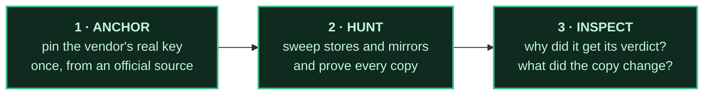
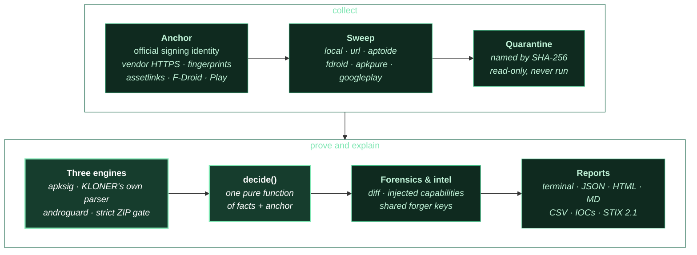
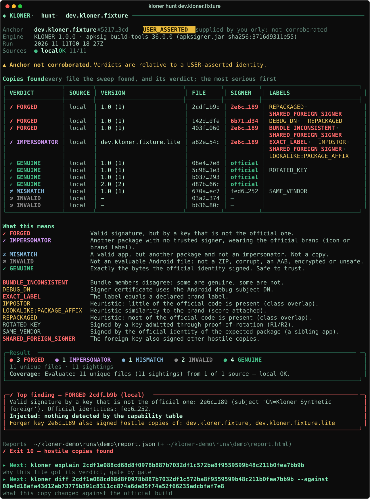
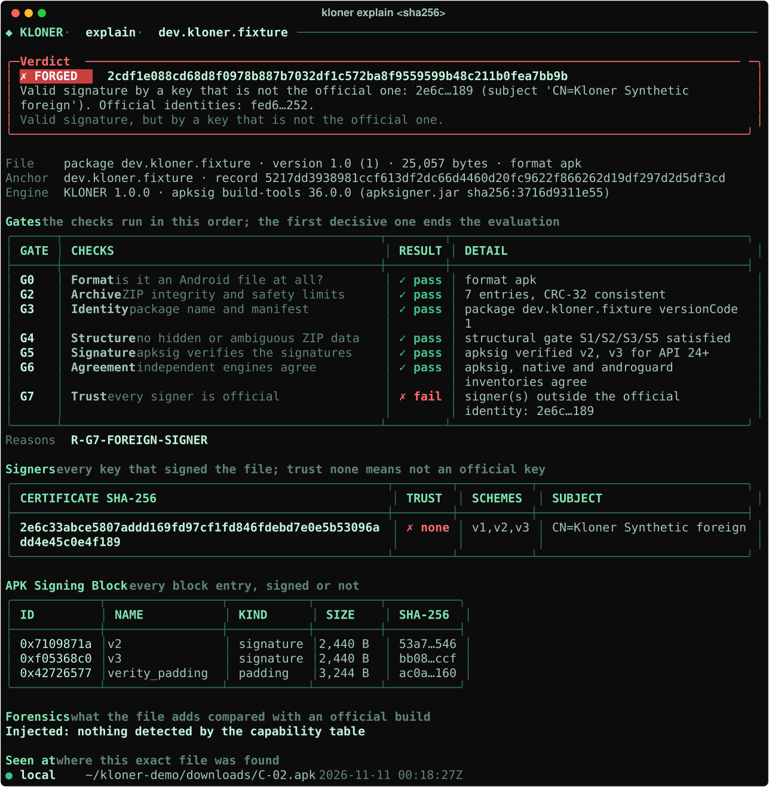
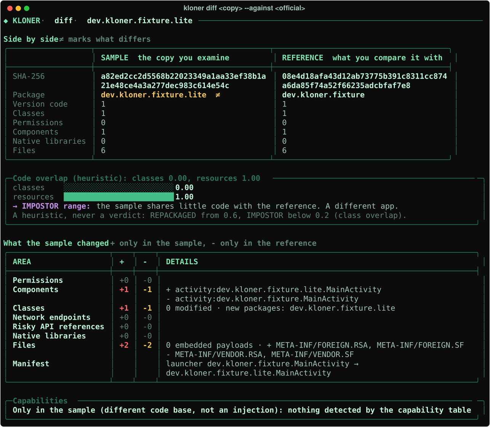
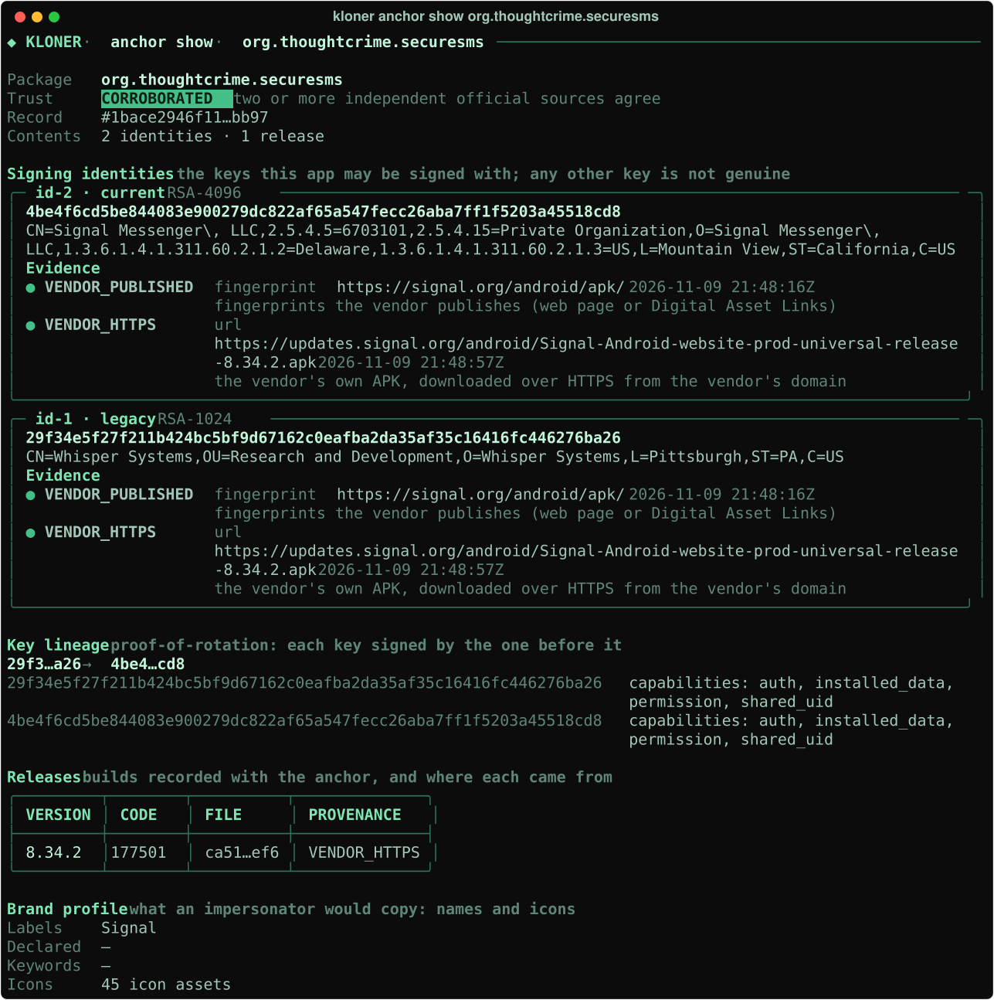
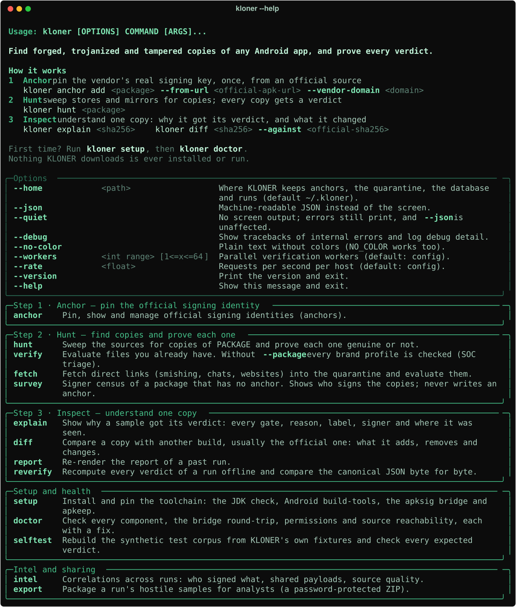
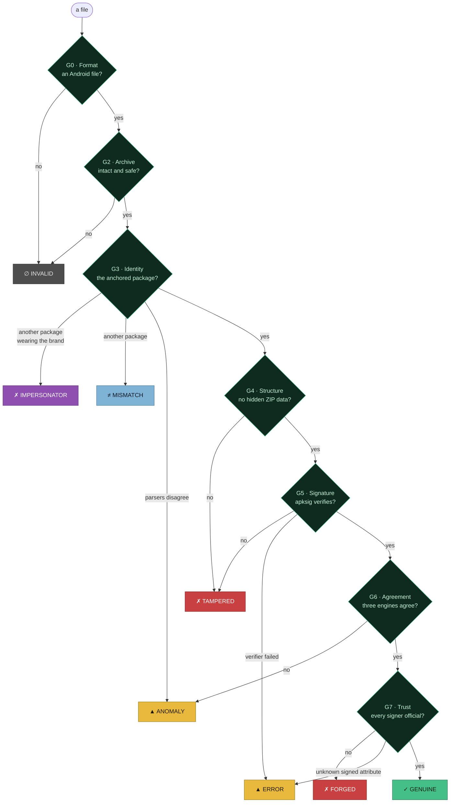
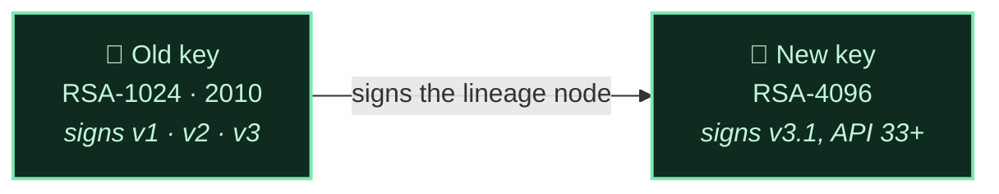

<p align="center">
  
</p>

<h3 align="center">Looks can be cloned. Keys cannot.</h3>

<p align="center">
  Hunt forged, trojanized and tampered copies of any Android app across the internet,<br>
  and prove every verdict with the cryptography Android itself uses.
</p>

<p align="center">
  <a href="https://github.com/0xKript/KLONER/actions/workflows/ci.yml"></a>
  
  
  
  
</p>

<p align="center">
  <a href="#the-idea">The idea</a> ·
  <a href="#how-it-works">How it works</a> ·
  <a href="#see-it">See it</a> ·
  <a href="#quick-start">Quick start</a> ·
  <a href="#your-first-hunt-step-by-step">First hunt</a> ·
  <a href="#reading-the-screen">Reading the screen</a> ·
  <a href="#verdicts">Verdicts</a> ·
  <a href="#commands">Commands</a> ·
  <a href="#faq">FAQ</a>
</p>

---

## The idea

A banking app, a messenger, a wallet: the apps people trust most are the ones attackers clone. They take the
real app, slip their own code inside, sign the result with their own key, and spread it through APK mirrors,
third-party stores, chat groups and smishing links. The copy has the same name, the same icon, the same
screenshots and the same version number. To a person, it **is** the app.

Every Android app carries a signature, made with a private key that only the vendor holds. Think of it as a wax
seal that cannot be forged: whoever changes even one byte of the app breaks the seal, and has to seal it again with
their own stamp. Android checks that seal before it installs an update.

So KLONER asks every copy one question, the only question that cannot be faked:

> **Was this file signed by the vendor's own key, and is it exactly what that key signed?**

It learns the vendor's real key once, from an official source. It sweeps the places where copies live. And for
every file it finds, it answers that question with Google's own verifier, apksig, then shows its work.

<table>
<tr>
<td width="33%" valign="top">

**Not a scanner**

A malware scanner guesses from patterns and gives a probability. KLONER gives a proof: a deterministic
computation over the file's bytes, which `kloner reverify` reproduces byte for byte.

</td>
<td width="33%" valign="top">

**Not a certificate check**

The certificate inside an APK is public; an attacker can copy it into a modified file. KLONER asks apksig whether
the signature validates *this* content.

</td>
<td width="33%" valign="top">

**Not a diff tool**

Diff tools compare files you already have. KLONER goes and finds the copies, judges each one, and only then
explains what changed.

</td>
</tr>
</table>

> [!IMPORTANT]
> **GENUINE is a proof of origin, not a verdict on behavior.** It means the vendor signed exactly these bytes.
> What the vendor itself ships is out of scope.

### The philosophy

1. **Proof, not probability.** A verdict is a computation over bytes, never a score, a model or a heuristic.
2. **Trust comes from the vendor, and only from the vendor.** Keys are pinned from official sources. Nothing seen
   on a mirror can ever add a key.
3. **Fail closed.** When independent engines disagree, KLONER says ANOMALY and refuses to certify, instead of
   guessing.
4. **Never run a sample.** Nothing is installed, executed, emulated or uploaded. Files are only parsed.
5. **Show the work.** Every verdict has a gate-by-gate trace, reason codes and the anchor's record hash.
6. **Say what was covered.** "No hostile copies" always means "among N files from these sources".

## How it works

Three steps, always in this order:



| Step | Command | What it does |
|---|---|---|
| **1 · Anchor** | `kloner anchor add <package> --from-url <official-apk> --vendor-domain <domain>` | Learns the vendor's signing keys from an official source, with evidence, and keeps them as the *anchor* |
| **2 · Hunt** | `kloner hunt <package>` | Finds every copy it can, downloads each into a quarantine, and gives each one a verdict |
| **3 · Inspect** | `kloner explain <sha256>` · `kloner diff <copy> --against <official>` | Shows why a file got its verdict, gate by gate, and what a copy adds or removes |

Under the hood, every file goes down the same path:



1. **Anchor.** The vendor's signing certificates, taken only from official provenance and printed with a record
   hash in every report.
2. **Sweep.** Sources discover offers and stream every file into a quarantine named by its SHA-256.
3. **Verify.** Google's apksig (the library behind `apksigner`) verifies every signature scheme. KLONER's own
   signing-block parser and androguard list the signers independently, and all three must agree. A strict ZIP
   parser enforces a structural gate, and two manifest parsers (androguard and aapt2) must agree on the package.
4. **Decide.** One pure function turns those facts into a verdict. No heuristic, score or model is involved.
5. **Explain.** For hostile copies, forensics show what changed, and correlations link copies that share a
   forger's key or an injected payload.

## See it

Every screen below is real KLONER output, run offline on the test corpus that `kloner selftest` builds (its files
are anchored from a local file, hence USER_ASSERTED). The anchor screen shows Signal's real anchor from the field
trial. `python scripts/export_screens.py` regenerates them.

**A hunt.** Every copy with its verdict, the most serious first. Under the table: what each verdict and label on
the screen means, the result, the top finding, and the exact command to run next.

<p align="center"></p>

**Why this verdict?** `kloner explain` walks the gates in order. This copy passes everything up to G7, where its
signer turns out not to be the vendor's.

<p align="center"></p>

**The copy next to the original.** `kloner diff` puts the copy and the reference side by side, measures how much
code they share, and lists what changed, area by area.

<p align="center"></p>

**An anchor.** Signal publishes two keys: the 2010 RSA-1024 key and its RSA-4096 successor. The anchor holds
both, each with its evidence, and the proof-of-rotation lineage that links them.

<p align="center"></p>

<details>
<summary><b>The help screen</b>: commands grouped by the three steps, every option explained</summary>
<br>
<p align="center"></p>
</details>

## Quick start

<details open>
<summary><b>Windows: Docker Desktop</b> (PowerShell, nothing else to install)</summary>

The image holds the JDK, the pinned Android build-tools, apkeep and KLONER. Your anchors, quarantine and database
live on the `kloner-home` volume.

Building the image installs Google's Android build-tools, which requires the Android SDK License Agreement. Read it
at <https://developer.android.com/studio/terms>. The build argument `ACCEPT_ANDROID_SDK_LICENSE=yes` is your
acceptance: the build accepts only the license of the packages it installs, and prints its text in the build log.

```powershell
git clone https://github.com/0xKript/KLONER.git
cd KLONER
docker build --build-arg ACCEPT_ANDROID_SDK_LICENSE=yes -t kloner .
docker volume create kloner-home
docker run --rm -t -e COLORTERM -e WT_SESSION -v kloner-home:/kloner kloner doctor
docker run --rm -t -e COLORTERM -e WT_SESSION -v kloner-home:/kloner kloner selftest
```

Then the three steps, for Signal:

```powershell
# 1 · anchor: the fingerprints Signal publishes, then Signal's own APK from signal.org
docker run --rm -t -e COLORTERM -e WT_SESSION -v kloner-home:/kloner kloner anchor add org.thoughtcrime.securesms --from-fingerprint 29f34e5f27f211b424bc5bf9d67162c0eafba2da35af35c16416fc446276ba26 4be4f6cd5be844083e900279dc822af65a547fecc26aba7ff1f5203a45518cd8 --evidence-url https://signal.org/android/apk/
$apk = (Invoke-RestMethod https://updates.signal.org/android/latest.json).url
docker run --rm -t -e COLORTERM -e WT_SESSION -v kloner-home:/kloner kloner anchor add org.thoughtcrime.securesms --from-url $apk --vendor-domain signal.org

# 2 · hunt: the official link and F-Droid, reports written to .\reports\signal
docker run --rm -t -e COLORTERM -e WT_SESSION -v kloner-home:/kloner -v "${PWD}\reports:/reports" kloner hunt org.thoughtcrime.securesms --sources url,fdroid --url $apk --out /reports/signal --format terminal,json,html
```

`-t` gives the container a terminal, so colors and the startup banner show. `-e COLORTERM -e WT_SESSION` pass your
terminal's true-color hints into the container. Leave `-t` out when you capture the output.

If you already accepted the license in Android Studio, reuse that acceptance and build without the argument:

```powershell
Copy-Item "$env:LOCALAPPDATA\Android\Sdk\licenses\android-sdk-license" docker\android-licenses\
docker build -t kloner .
```

With neither, the build stops before downloading anything and prints both options. The license is never accepted
silently.

</details>

<details>
<summary><b>Linux or macOS</b> (Python 3.11+, a JDK 17+ and <a href="https://docs.astral.sh/uv/">uv</a>)</summary>

```bash
git clone https://github.com/0xKript/KLONER.git && cd KLONER
uv venv && . .venv/bin/activate
uv pip install --require-hashes -r requirements.lock && uv pip install --no-deps .
kloner setup            # JDK check, pinned Android build-tools 36.0.0, apkeep, the apksig bridge
kloner doctor           # every component PASS or WARN, each with its fix
kloner selftest         # the whole pipeline on KLONER's own test files
```

`kloner setup` shows the Android SDK license and asks before installing anything
(`--accept-android-sdk-license` accepts it without a prompt, once you have read it).

</details>

<details>
<summary><b>Windows: WSL2 (Ubuntu)</b></summary>

Inside an Ubuntu terminal (`wsl -d Ubuntu`):

```bash
sudo apt-get update && sudo apt-get install -y git curl openjdk-17-jdk-headless
curl -LsSf https://astral.sh/uv/0.13.7/install.sh | sh
source "$HOME/.local/bin/env"
git clone https://github.com/0xKript/KLONER.git && cd KLONER
uv venv && . .venv/bin/activate
uv pip install --require-hashes -r requirements.lock && uv pip install --no-deps .
mkdir -p ~/.kloner/toolchain/android-sdk/licenses
cp "$(wslpath "$(powershell.exe -NoProfile -Command '$env:LOCALAPPDATA' | tr -d '\r')")/Android/Sdk/licenses/android-sdk-license" ~/.kloner/toolchain/android-sdk/licenses/
kloner setup
kloner doctor
kloner selftest
```

The `mkdir`/`cp` lines reuse the Android SDK license you accepted in Android Studio on Windows. Skip them to have
`kloner setup` show the license and ask.

</details>

## Your first hunt, step by step

### Step 1 · Anchor: tell KLONER who the real vendor is

An anchor is the vendor's signing identity for one package: its keys, the evidence for each key, the key lineage
when the vendor rotated keys, and the official releases KLONER has seen. Pick the strongest method the vendor
offers. Two different official methods make the anchor **CORROBORATED**.

| If the vendor offers… | Run | Evidence |
|---|---|---|
| its APK on its own website | `kloner anchor add <pkg> --from-url <apk-url> --vendor-domain <domain>` | VENDOR_HTTPS |
| its key fingerprints on a web page | `kloner anchor add <pkg> --from-fingerprint <sha256>… --evidence-url <page>` | VENDOR_PUBLISHED |
| a Digital Asset Links file | `kloner anchor add <pkg> --from-assetlinks <domain>` | VENDOR_PUBLISHED |
| an F-Droid build | `kloner anchor add <pkg> --from-fdroid` | FDROID_INDEX |
| Google Play (your account) | `kloner anchor add <pkg> --from-play` | PLAY_API |
| an app installed from an official store | `kloner anchor add <pkg> --from-device` | STORE_INSTALL |
| nothing official you can reach | `kloner anchor add <pkg> --from-apk <file>` | USER (not corroborated) |

```bash
kloner anchor add org.wikipedia --from-assetlinks en.wikipedia.org    # Wikimedia's own assetlinks.json
kloner anchor add org.wikipedia --from-fdroid                         # a second, independent source
kloner anchor show org.wikipedia
```

> [!TIP]
> Evidence that shares no key with the anchor is a **CONFLICT**: nothing is written and KLONER exits 3. That is
> how a hijacked download page or a wrong file is caught before it can become trust. A legitimate second key (an
> app store that signs its own builds) is added only on purpose, with `--declare-additional-identity --reason`.

### Step 2 · Hunt: find the copies and judge each one

```bash
kloner hunt org.wikipedia                                  # every enabled source, the latest version
kloner hunt org.wikipedia --all-versions --impersonators   # every version, plus apps that copy the brand
kloner hunt org.wikipedia --sources url,fdroid --url <official-apk-url>
kloner hunt com.example.app --sources local --local ./downloads    # files you already have
```

Each file is downloaded into the quarantine, never installed or run, and judged against the anchor. The run
writes its reports (`--format terminal,json,md,html,csv,iocs,stix21`) to `--out`, or to `~/.kloner/runs/<run-id>`.

### Step 3 · Inspect: understand one copy

```bash
kloner explain <sha256>                          # why this file got its verdict, gate by gate
kloner diff <sha256> --against <official-sha256>  # what the copy adds, removes and changes
kloner reverify <run-id>                          # recompute every verdict offline: IDENTICAL, byte for byte
kloner report <run-id> --format html             # re-render a past run
```

The hunt screen prints the exact `explain` and `diff` commands for its top finding, ready to copy.

## Reading the screen

The hunt, verify and fetch screens share one layout, so you always know where to look:

| Part | What it tells you |
|---|---|
| **◆ KLONER · hunt · package** | the command and the package, on the first line |
| **Anchor · Engine · Run · Sources** | which anchor judged the files, its trust level, the verifier version, the run id, and every source with its status (● OK, ○ no offers, ▲ blocked, ✗ error, · disabled) |
| **Copies found** | one row per file: verdict, where it was seen, version, file hash, signer (*official*, or the foreign key), labels |
| **What this means** | the meaning of every verdict and label on the screen, and only those |
| **Result** | the counts per verdict, how many files and sightings, and the coverage sentence |
| **Top finding** | the first hostile copy: why, what it injects, and which other copies share its forger key |
| **Exit · Next** | the exit code in words, and the next command to run |

Colors follow the tool: **green** is the vendor and GENUINE, **red** is hostile (FORGED, TAMPERED), **violet** is an
impersonator, **amber** asks you to review, **blue** is an unrelated app, **grey** is not an app at all. Every color
comes with a word and a symbol (✓ ✗ ▲ ≠ ∅), so nothing depends on color alone: `--no-color` and `NO_COLOR` give
the same screen in plain text. On a terminal narrower than 100 columns, the results table drops its vertical borders
so the labels keep their width.

`--json` prints the canonical JSON document, and only that, instead of the screen, for scripts and CI. While a long
step runs, a spinner shows what KLONER is doing. It is drawn on stderr, only when stderr is a terminal, never with
`--json` or `--quiet` or in CI, and it never touches stdout.

## Verdicts

| | Verdict | Class | Meaning |
|:---:|---|---|---|
| ✓ | **GENUINE** | Clean | Exactly the bytes the official identity signed |
| ✗ | **TAMPERED** | Hostile | Claims to be the package, but was modified after signing or is structurally weaponized |
| ✗ | **FORGED** | Hostile | Valid signatures, but at least one signer is outside the official identity |
| ✗ | **IMPERSONATOR** | Hostile | Another package with no trusted signer that presents the official brand (byte-identical icon or a declared brand label) |
| ▲ | **ANOMALY** | Review | Engines or parsers disagree; KLONER refuses to certify the file |
| ▲ | **ERROR** | Review | The evaluation could not complete (timeout, crash, outdated verifier) |
| ≠ | **MISMATCH** | Not applicable | A valid file, but another package and not an impersonator |
| ∅ | **INVALID** | Not applicable | Not an evaluable artifact (not a ZIP, corrupt, AAB, encrypted, unsafe archive) |
| ○ | **UNANCHORED** | Not applicable | No anchor for the package and no brand match |

How a file reaches its verdict: the gates run in this order, and the first decisive one ends the evaluation.



Every verdict carries reason codes, labels and this gate-by-gate trace (`kloner explain <sha256>`). The full label
and reason-code tables are in [docs/VERDICTS.md](docs/VERDICTS.md).

## What KLONER catches

| | Attack | KLONER's answer |
|---|---|---|
| T-01 | Repackage, inject code, re-sign with your own key | **FORGED**, plus REPACKAGED and the injected-capability summary |
| T-02 | Re-sign with an AOSP test key or a debug certificate | **FORGED** + KNOWN_PUBLIC_KEY:\<name\> / DEBUG_DN |
| T-03 | Copy the official signature into a modified file (signature transplant) | **TAMPERED** + CONTENT_MODIFIED_UNDER_OFFICIAL_SIGNATURE |
| T-04 | Change bytes in place and recompute CRCs | **TAMPERED** |
| T-05 | Janus-style polyglot: data before the ZIP (CVE-2017-13156) | **TAMPERED** + POLYGLOT |
| T-06 | ZIP ambiguity: duplicate names, local/central mismatch (Master Key class) | **TAMPERED** + ZIP_AMBIGUITY |
| T-07 | Strip v2/v3 to downgrade to a weaker scheme | **TAMPERED** + SCHEME_STRIPPED |
| T-08 | Hybrid signers: keep official blocks, add attacker blocks | **FORGED** + MIXED_SIGNERS (never GENUINE) |
| T-09 | Forged key rotation | **TAMPERED** or **FORGED**: a lineage from an untrusted block grants nothing |
| T-10 | Bundle smuggling: a re-signed split or an extra APK in an XAPK/APKM/APKS | **FORGED** / **ANOMALY** + BUNDLE_INCONSISTENT / UNEXPECTED_MEMBER |
| T-11 | Unrelated code under the official package name | **FORGED** + IMPOSTOR |
| T-12 | The official icon or brand label under another package | **IMPERSONATOR** + EXACT_ICON / EXACT_LABEL |
| T-13 | Data injected into the unsigned part of the signing block | **GENUINE** + UNSIGNED_BLOCK_DATA, every pair listed |
| T-14 | Unknown or future signature blocks and attributes | Their certificates join the signer check; an unknown signed attribute gives **ERROR**, never GENUINE |
| T-15 | Malformed manifests that parsers read differently | **ANOMALY** (parsers disagree) |
| T-16 | A mirror lying about version, hash or signer | METADATA_MISMATCH against that source |
| T-17 | A mirror serving different bytes to different clients | Verdicts bound to observed bytes; client profile in every sighting; UNSTABLE_SOURCE on re-fetch mismatch |
| T-18 | Attacks on KLONER itself: zip bombs, path traversal, huge or malformed structures | **INVALID** / **ERROR**, bounded parsing, nothing written outside the home |
| T-19 | An old, superseded key signing a "new" build | **GENUINE** + LEGACY_KEY_ON_NEW_BUILD alert |

### The signature-transplant showcase

A naive check reads the certificate stored in the APK, for example with
`unzip -p app.apk 'META-INF/*.RSA' | openssl pkcs7 -inform DER -print_certs`. That certificate is public data, and it
can sit unchanged in a file whose content changed. KLONER instead asks apksig whether the signature validates *this*
content. Two real files from AOSP's apksig test suite: a correctly signed APK, and the same APK whose content no
longer matches its signature, with the official certificate still inside:

```text
$ kloner verify v2-only-with-ecdsa-sha256-p256.apk v2-only-with-ecdsa-sha256-p256-digest-mismatch.apk \
    --package android.appsecurity.cts.tinyapp

  VERDICT      SOURCE  VERSION    FILE      SIGNER    LABELS
  ✗ TAMPERED   local   1.0 (10)   b410…354  6a8b…599  CONTENT_MODIFIED_UNDER_OFFICIAL_SIGNATURE · REPACKAGED
  ✓ GENUINE    local   1.0 (10)   f2b3…1a1  official  LEGACY_PLATFORM_INCOMPATIBLE

  ✗ Top finding — TAMPERED b410…354 (local)
    The file was modified after it was signed: V2_SIG_APK_DIGEST_DID_NOT_VERIFY. The official certificate is
    present, but it does not validate this content.
  ✗ Exit 10 — hostile copies found
```

The test suite pins 117 such files from AOSP by commit and SHA-256, and checks 133 cases against exactly the verdict
and labels recorded for each. They include stripped signature schemes, invalid rotation lineages, a second signer
added next to the official one, the public AOSP test key, and ZIP layouts the structural gate refuses. Cases that
need a file no public suite provides, such as a signature copied from one app into another, are decided at the
**facts level**: real facts of a vendor-signed file, changed only in the data the decision sees.

## The guarantee

For every copy of package P, given the anchor's trusted keys:

- **GENUINE** means all of the following hold. The file passes intake, archive integrity and the structural gate.
  apksig verifies every signature scheme in it. Both manifest parsers agree it is P. All three signer inventories
  agree. Every signer certificate, in every signature block and for every platform range, belongs to the trust
  closure: the anchored keys, plus keys that an anchored key endorsed through APK key rotation (R1/R2).
- **FORGED** means the same, except that at least one signer is outside the trust closure.
- **TAMPERED** means the file claims to be P and either violates the structural gate, or is structurally sound and
  CRC-consistent but fails signature verification on every checked platform range.

Every condition is a deterministic computation over the file's bytes. The same sample, anchor, KLONER version and
verifier version always give the same verdict, and `kloner reverify` recomputes a run and compares the verdict JSON
byte for byte.

<details>
<summary><b>The boundary</b>: exactly what KLONER does and does not claim</summary>

- **B1, anchor correctness.** Verdicts are relative to the anchor. KLONER guards anchor creation with
  official-provenance methods only, corroboration levels, hygiene checks, conflict hard stops, and the anchor record
  hash in every report.
- **B2, coverage.** KLONER judges the copies it obtains, and every report says exactly what was covered. Any file or
  URL can be fed in directly.
- **B3, vendor-key compromise.** Someone holding the vendor's private key produces APKs that are cryptographically
  indistinguishable from the vendor's, for Android too. KLONER raises provenance alerts (AHEAD_OF_OFFICIAL,
  LEGACY_KEY_ON_NEW_BUILD) but cannot turn them into verdicts.
- **B4, benignity.** GENUINE certifies origin, not behavior. What the vendor itself ships is out of scope.
- **B5, unsigned regions.** For v2+ APKs, only the non-signature entries of the APK Signing Block are unsigned, and
  KLONER lists every one of them. For v1-only APKs, ZIP metadata outside entry contents is unsigned; KLONER enforces
  the structural gate and labels the file V1_ONLY.
- **B6, expansion files.** OBB files inside bundles are not covered by APK signatures. They are hashed and labeled
  UNVERIFIABLE_OBB.

</details>

## Anchors in depth

**Corroboration.** CORROBORATED means two distinct official provenance classes agree on the current identity.
SINGLE_OFFICIAL means one class. USER_ASSERTED means user evidence only, and every report then says "Anchor not
corroborated". `kloner hunt --require-corroborated` refuses anything below CORROBORATED. Keys found in the AOSP
test-key registry are rejected.

**Key rotation, the Signal story.** signal.org publishes two fingerprints: the 2010-era RSA-1024 key and an RSA-4096
key. In the field trial, KLONER read Signal's 8.34.2 APK and found v1, v2 and v3 signed by the old key (v3 for API
24–32, with rotation-min-sdk 33), plus a v3.1 block for API 33+ signed by the new key. That v3.1 block carries a
proof-of-rotation lineage old → new, whose node signature is valid.



An anchor holding *either* key alone certifies the file. With only the new key, the lineage it signed endorses the
old one (**R1**). With only the old key, the old key signed the new key's lineage node (**R2**). Both were proven
live. A lineage asserted by an untrusted block grants nothing.

**Play App Signing.** For apps that use Play App Signing, the fingerprint that matters is Google's **app signing
key**, not the developer's upload key. Play-distributed APKs carry the app signing key, and vendors usually publish
that key's SHA-256 on their page or in `assetlinks.json`.

**Several legitimate identities.** DuckDuckGo signs its own builds. F-Droid builds the same app from source and signs
it with F-Droid's key. Anchoring from duckduckgo.com and then adding F-Droid's evidence gives a CONFLICT by design.
The owner resolves it explicitly, and the decision is logged in the anchor:

```bash
kloner anchor add com.duckduckgo.mobile.android --from-fdroid --declare-additional-identity \
    --reason "F-Droid builds DuckDuckGo from source and signs it with its own repository key" --label f-droid
```

Copies from both channels are then GENUINE, and the F-Droid ones are labeled SECONDARY_IDENTITY. `anchor show`,
`list`, `refresh [--accept]`, `export`/`import` and `adopt-rotation` manage anchors over time. See
[docs/ANCHORS.md](docs/ANCHORS.md).

## Sources

| Source | How | Credentials | Default |
|---|---|---|---|
| `local` | files and directories (`--local PATH`) | — | on |
| `url` | direct links (`--url URL`, `kloner fetch`); plain HTTP allowed and labeled INSECURE_TRANSPORT | — | on |
| `aptoide` | Aptoide web services v7, with per-store offers and Aptoide's claimed MD5 and signer | — | on |
| `fdroid` | the official F-Droid repository index (hash-checked, cached) | — | on |
| `apkpure` | apkeep 1.1.0 | — | on |
| `googleplay` | apkeep 1.1.0 | `KLONER_PLAY_EMAIL`, `KLONER_PLAY_AAS_TOKEN` | off without credentials |
| `huawei` | disabled: apkeep 1.1.0 dropped its AppGallery downloader, and there is no public API | — | reports DISABLED |
| `uptodown`, `apkcombo`, `apkmirror` | not shipped: no stable public API, and bot protection KLONER will not bypass | — | off |

Credentials come from environment variables only and never reach logs, the database or reports. Every source is
isolated: one failure never affects another, and every status (OK, NO_OFFERS, BLOCKED, ERROR, DISABLED) appears on
the screen and in the coverage sentence. A source is a small Python class with `discover`, `search` and `fetch`; see
[docs/SOURCES.md](docs/SOURCES.md).

## Commands

`kloner --help` groups the commands by the three steps, and every command's `--help` explains each option, with
examples.

| Step | Command | What it does |
|---|---|---|
| **1 · Anchor** | `kloner anchor add <package> --from-…` | pin the official identity from one official method |
| | `kloner anchor show <package>` · `list` | the anchor: identities, evidence, lineage, releases, brand |
| | `kloner anchor refresh <package> [--accept]` | re-run the recorded methods and show what changed |
| | `kloner anchor export <package> <file>` · `import <file>` | portable anchors; import re-checks everything |
| | `kloner anchor adopt-rotation <package> <sha256>` | persist a rotation that a GENUINE sample proves |
| **2 · Hunt** | `kloner hunt <package> [--sources …] [--all-versions] [--impersonators]` | sweep the sources and prove every copy |
| | `kloner verify <file>… [--package P]` | judge files you already have; without `--package`, every brand is checked |
| | `kloner fetch <url>… [--package P]` | download links (smishing, chats, sites) into the quarantine and judge them |
| | `kloner survey <package>` | who signs the copies of an app you have not anchored; never writes an anchor |
| **3 · Inspect** | `kloner explain <sha256>` | the gate-by-gate trace of one verdict |
| | `kloner diff <copy> --against <reference>` | the copy next to the reference: overlap and every change |
| | `kloner report <run-id> --format …` | re-render a past run |
| | `kloner reverify <run-id>` | recompute every verdict offline and compare byte for byte |
| **Setup** | `kloner setup` · `doctor` · `selftest [--quick \| --full]` | install, check and prove the toolchain |
| **Intel** | `kloner intel signer <sha256>` · `payload <id>` · `package <package>` · `sources` | correlations across runs |
| | `kloner export samples --run <run-id>` | hostile samples for analysts, in a password-protected ZIP |

Global options: `--home DIR` (default `~/.kloner`), `--json`, `--quiet`, `--debug`, `--no-color`, `--workers N`,
`--rate R`.

Bare `kloner`, `--help`, `--version`, `hunt`, `verify`, `fetch`, `survey`, `doctor` and `selftest` start with the
banner, on stderr, when stdout and stderr are both terminals. It never shows with `--json` or `--quiet`, when output
is piped or redirected, or in CI, and `KLONER_NO_BANNER=1` turns it off.

| Exit code | Meaning |
|:---:|---|
| **0** | Run complete: no hostile verdicts, no ANOMALY/ERROR |
| **10** | Hostile verdicts present (TAMPERED, FORGED, IMPERSONATOR; change the set with `--fail-on`) |
| **11** | No hostile verdicts, but ANOMALY or ERROR present |
| **2** | Usage or configuration error (for example, no anchor) |
| **3** | Anchor conflict or hygiene failure |
| **4** | The authoritative verifier is missing or below the minimum version: no verdicts at all |
| **5** | Run aborted by an internal error |

## Reports and integrations

`--format` writes `report.json` (schema `kloner.report/1`), self-contained `report.md` and `report.html`,
`samples.csv`, `iocs.txt`/`iocs.csv` and a STIX 2.1 bundle. Every report states its coverage, the anchor's record
hash and corroboration level, and the tool versions. Runs also write structured JSON-lines logs to
`~/.kloner/logs/`.

Scheduled monitoring, reporting only files never seen before:

```bash
# crontab: every 6 hours
0 */6 * * * kloner hunt com.example.bank --new-only --impersonators --format json,html,iocs --out /srv/kloner/$(date +\%F-\%H) --notify-webhook https://hooks.example.com/kloner
```

`--notify-webhook` POSTs the JSON summary (run, counts, coverage) when hostile copies are found. That works with
Slack- or Teams-style incoming webhooks.

In CI, gate a monitoring job on the exit code:

```bash
kloner hunt com.example.bank --new-only --format json --out reports/
case $? in
  0)  echo "no hostile copies, no review items" ;;
  10) echo "hostile copies found: see reports/report.json"; exit 1 ;;
  11) echo "review items (ANOMALY/ERROR)"; exit 1 ;;
  *)  echo "KLONER could not run"; exit 1 ;;
esac
```

To gate a release, require the verdict itself. Exit 0 alone also covers MISMATCH or INVALID:

```bash
verdict=$(kloner --json verify dist/app-release.apk --package com.example.bank | jq -r '.samples[0].evaluation.verdict')
[ "$verdict" = GENUINE ] || { echo "release build is $verdict, not GENUINE"; exit 1; }
```

## Use cases

| Who | How |
|---|---|
| **Bank and government SOCs** | brand protection: a scheduled `hunt --new-only --impersonators` with webhook alerts |
| **Smishing triage** | `kloner fetch <link> --package <P>` downloads the file behind a link into the quarantine and answers whether it is the real app |
| **CERTs** | takedown evidence: the HTML report, IOCs, the STIX bundle, sightings with URLs and timestamps, and `kloner export samples` (an AES-256 ZIP, never an unprotected archive) |
| **Researchers** | repackaging campaigns: `kloner intel signer <cert>` and `intel payload <id>` link copies that share a forger's key or an injected payload, across packages and runs |
| **Vendors** | their own distribution: `kloner verify` in the release pipeline, and `kloner hunt` across stores to see what is out there under their name |

## Safety and ethics

- Samples are never installed, executed, emulated or uploaded. They are stored content-addressed, read-only and
  without extensions, in a quarantine.
- Every parser is bounded in size, compression ratio, entry count and time. Hostile files are parsed in worker
  processes with timeouts, plus address-space and CPU limits on Linux. apksig runs in its own JVM with a heap cap.
- KLONER uses an honest User-Agent and rate-limits to 1 request per second per host by default. Bot protection is
  never bypassed; a challenge page is recorded as BLOCKED.
- Mirrors cannot add trust: only official provenance creates anchors, and `kloner survey` displays signers but never
  writes an anchor.

## Installation details

Requirements: Python 3.11+, a JDK 17+ (Temurin recommended), and network access for `kloner setup`.

| Platform | Status |
|---|---|
| **Linux** | validated on Ubuntu 24.04 (WSL2 and CI) and in the Docker image (Debian 13) |
| **macOS** | validated in CI on macOS 15 (arm64); apkeep publishes no macOS build, so `apkpure` and `googleplay` report DISABLED, and `doctor` notes that worker address-space limits are not applied |
| **Windows** | Docker Desktop or WSL2, as in the quick start; KLONER also runs natively, and `doctor` then notes that POSIX worker limits are unavailable |

`kloner setup` pins Android build-tools 36.0.0 and refuses any `apksigner.jar` whose SHA-256 differs from the pinned
one. It installs apkeep 1.1.0 (checksum-verified) and compiles the apksig bridge. An existing Android SDK that
already holds build-tools 36.0.0 is reused.

The Docker image (Debian slim, Temurin 17, pinned build-tools, apkeep and KLONER; base images pinned by digest) keeps
its toolchain in `/opt/kloner/toolchain`, so a volume or host folder on `/kloner` never hides it. Inside the image,
`kloner doctor` passes every check, POSIX worker limits included, and `kloner selftest --full` passes 55/55.

`python scripts/build_sbom.py` writes a CycloneDX SBOM of the locked dependencies and the pinned toolchain; CI uploads
it with every run, and each release attaches it.

## FAQ

<details>
<summary><b>Why not just compare certificates?</b></summary>
<br>
The certificate inside an APK is public. A signature transplant copies it into a modified file. Only verifying the
signature against the file's contents proves anything, and KLONER does that with Google's apksig.
</details>

<details>
<summary><b>Does GENUINE mean safe?</b></summary>
<br>
No. GENUINE certifies origin: these are exactly the bytes the vendor signed. What the vendor ships is out of scope.
</details>

<details>
<summary><b>What about Play App Signing?</b></summary>
<br>
Anchor Google's app signing key, which is the one on Play-distributed APKs, not your upload key.
</details>

<details>
<summary><b>What about key rotation?</b></summary>
<br>
Supported through APK Signature Scheme v3/v3.1 proof-of-rotation: an anchor with either the old or the new key
certifies properly rotated builds (R1/R2). The Signal story above shows both.
</details>

<details>
<summary><b>What if an app has several legitimate keys?</b></summary>
<br>
An anchor can hold several identities: several fingerprints in `assetlinks.json`, or an explicitly declared
additional identity with a reason (the DuckDuckGo and F-Droid case).
</details>

<details>
<summary><b>Can KLONER miss copies?</b></summary>
<br>
Yes. It judges the copies it can obtain, and every report says which sources were queried, which failed or were
blocked, and how many files were evaluated. "No hostile copies" always means "among N files from sources X".
</details>

<details>
<summary><b>Why is a file from a mirror INVALID?</b></summary>
<br>
It is not an evaluable APK: a truncated or corrupt download, an HTML page saved as `.apk`, an AAB, or an encrypted or
unsafe archive, such as one whose entries overlap. A corrupt network download is re-fetched once, and corruption is
never reported as TAMPERED.
</details>

<details>
<summary><b>Why ANOMALY instead of a verdict?</b></summary>
<br>
When the engines or the two manifest parsers disagree, KLONER refuses to certify the file rather than guess. It fails
closed.
</details>

<details>
<summary><b>Does KLONER ever run the apps it downloads?</b></summary>
<br>
Never. Files are only parsed, in bounded worker processes. Nothing is installed, executed, emulated or uploaded.
</details>

## Validation

Don't trust us, run it: `kloner selftest --full` regenerates the synthetic corpus from KLONER's own fixtures and
checks every case.

| | Result |
|---|---|
| **Live field trial** | 10 official files of Signal, Wikipedia, DuckDuckGo and Bitwarden, all **GENUINE**, with **0** hostile verdicts. Signal's key rotation proven live in both directions (R1 and R2). Wikipedia CORROBORATED from three official sources, two keys included. `reverify` IDENTICAL on all 9 hunts |
| **Third-party mirrors** | **22 GENUINE** copies of Signal, Wikipedia, DuckDuckGo and Bitwarden from official links, F-Droid and Aptoide, and **0** FORGED or IMPOSTOR among them; 54 unrelated apps with similar names kept apart as MISMATCH. The survey found a real **FORGED** `com.spotify.music` on Aptoide: a 1.1 MB app under Spotify's name, signed by an unknown key, with none of Spotify's code |
| **Real files from Google** | 133 cases on 117 test APKs of AOSP's apksig, pinned by commit and SHA-256, each with its exact verdict and labels |
| **Self-test** | `selftest --full`: 55/55 PASS in Docker, on Linux and on macOS (CI), including 38 corpus cases, 13 engine-agreement checks against `apksigner` and 1,200 random mutations of a signed file. Standard mode: 47/47 PASS in 39 s on 4 CPUs |
| **Tests** | 206 pytest tests, including property tests and fuzzing (1,000 iterations per parser). Line coverage on Linux CI: `decide.py` 98.8%, `verify/` 93.3%, `container/` 95.1%, `anchor/` 93.0%, overall 87.3% (gates 90/90/90/90/80). mypy --strict, ruff and bandit are clean |
| **Speed** | a 142 MB APK gets its verdict in about 3.5 s on 4 CPUs; Signal's 115 MB APK takes about 9 s, because its minSdk 23 also requires v1 verification of 4,115 entries |

Every number, with the commands and raw outputs, is in [docs/VALIDATION.md](docs/VALIDATION.md). Every claim in this
README is mapped to its evidence in [docs/CLAIMS.md](docs/CLAIMS.md).

## Roadmap

- Publish the Docker image (GHCR) with each release.
- Verify the F-Droid index signature (`entry.jar`) in addition to the TLS and hash chain.
- A harness for owner-run negative controls on real APKs, and file-level versions of the facts-level corpus cases.
- More sources where a stable public API exists.

## Author

Khel ([0xKript](https://github.com/0xKript)). Licensed under the [Apache License 2.0](LICENSE).

<p align="center"><sub>◆ KLONER · Looks can be cloned. Keys cannot.</sub></p>
